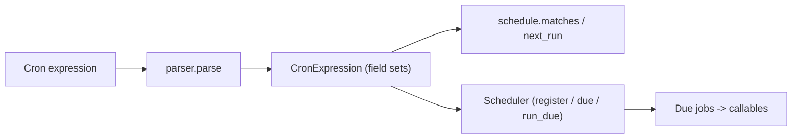

<p align="center">
  
</p>

<h1 align="center">Cron Job Scheduler</h1>

<p align="center">
  <strong>Parse standard cron expressions and compute next run times — pure Python, zero external cron libraries.</strong><br>
  Validate fields, match datetimes, and drive a tiny in-memory scheduler.
</p>

<p align="center">
  <em>Built and maintained by <a href="https://viprasol.com">Viprasol Tech</a> — Fintech Experts. Full-Stack Builders.</em>
</p>

<p align="center">
  <a href="https://github.com/Viprasol-Tech/cron-job-scheduler/actions/workflows/ci.yml"></a>
  <a href="LICENSE"></a>
  
  <a href="https://t.me/viprasol_help"></a>
  <a href="https://github.com/Viprasol-Tech/cron-job-scheduler/stargazers"></a>
</p>

---

> **Offline & dependency-light.** No system `cron`, no `croniter`, no network. Pure
> Python `datetime` does all the date math, so the parser, matcher, and scheduler
> are fully deterministic and trivial to test.

---

## Features

- **Real cron parser** — 5 fields (minute, hour, day-of-month, month, day-of-week)
  with `*`, lists (`1,2,3`), ranges (`1-5`), and steps (`*/15`, `10-30/5`).
- **Strict validation** — out-of-range values, inverted ranges, and bad tokens
  raise `CronParseError` instead of failing silently.
- **`next_run` & `matches`** — compute the next matching datetime or test any
  `datetime` against an expression, with classic cron day-of-month / day-of-week
  OR semantics.
- **In-memory scheduler** — register callables by cron expression, list due jobs
  for a given time, and run them deterministically.
- **CLI** — `cron-job-scheduler demo` and `cron-job-scheduler next "*/15 * * * *"`.
- **Modern tooling** — ruff, mypy (strict), pytest, GitHub Actions CI.

## Quickstart

```bash
git clone https://github.com/Viprasol-Tech/cron-job-scheduler.git
cd cron-job-scheduler
python -m pip install -e ".[dev]"

# Offline demo: expand a few expressions and drive the scheduler:
cron-job-scheduler demo

# Next 5 run times for an expression:
cron-job-scheduler next "*/15 * * * *"

# Does a datetime match?
cron-job-scheduler matches "0 9 * * 1-5" "2025-01-06 09:00"
```

## Usage in code

```python
from datetime import datetime
from cron_job_scheduler import matches, next_run, upcoming, Scheduler

# Next run after a reference time:
next_run("*/15 * * * *", datetime(2025, 1, 1, 10, 7))
# -> datetime(2025, 1, 1, 10, 15)

# Weekday 9am only:
matches("0 9 * * 1-5", datetime(2025, 1, 11, 9, 0))  # Saturday -> False

# A tiny in-memory scheduler:
log: list[str] = []
sched = Scheduler()
sched.register("backup", "0 9 * * 1-5", lambda: log.append("backup ran"))
sched.run_due(datetime(2025, 1, 6, 9, 0))  # Monday 09:00 -> ["backup"]

# Peek at the next few fire times:
upcoming("30 2 1 * *", datetime(2025, 1, 15, 0, 0), count=2)
```

## Architecture



## Roadmap

- [x] 5-field parser with `*`, lists, ranges, and steps
- [x] `matches`, `next_run`, `upcoming`, and in-memory `Scheduler`
- [ ] Named macros (`@daily`, `@hourly`, `@reboot`)
- [ ] Timezone-aware scheduling and DST handling
- [ ] Optional async runner with a real sleep loop

## Contributing

PRs welcome — see [CONTRIBUTING.md](CONTRIBUTING.md) and our [Code of Conduct](CODE_OF_CONDUCT.md).

## Contact — Viprasol Tech Private Limited

- Website: [viprasol.com](https://viprasol.com)
- Email: [support@viprasol.com](mailto:support@viprasol.com)
- Telegram: [t.me/viprasol_help](https://t.me/viprasol_help) | WhatsApp: +91 96336 52112
- GitHub: [@Viprasol-Tech](https://github.com/Viprasol-Tech) | [LinkedIn](https://www.linkedin.com/in/viprasol/) | X [@viprasol](https://twitter.com/viprasol)

## License

[MIT](LICENSE) (c) 2025 Viprasol Tech Private Limited
